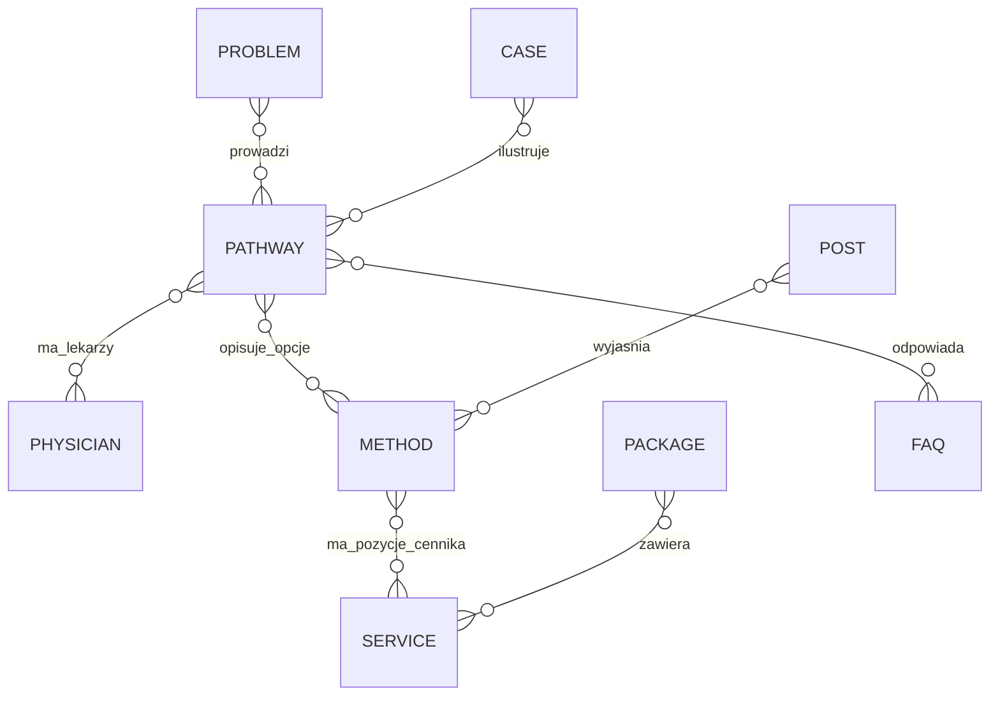

# Architektura WordPress NOVACELL — decyzje projektowe (v0.1)

Status: propozycja techniczna do wdrożenia etapowego. Podstawą jest wewnętrzna koncepcja strony z listopada 2026 r.; jej pełnych tekstów nie umieszczamy w publicznym repozytorium.

## Decyzja: najpierw model danych, później motyw, na końcu rozbudowa edytora

**Trzy elementy**, rozwijane w jednym repozytorium, z rozdzieloną odpowiedzialnością:

1. `plugins/novacell-manager/` — dane i powiązania, edycja WYSIWYG, rejestry, cennik, kontrola publikacji, API, importer oraz administracyjny kreator sekcji.
2. `plugins/novacell-visual-editor/` — nakładka nad natywnym edytorem blokowym WordPress, działająca wyłącznie w kontekście edycji blokowej. Nie przechowuje odrębnej wersji treści i nie zastępuje formatu bloków.
3. `themes/novacell/` — motyw blokowy (theme.json, szablony i wzorce), bez logiki domenowej.

Nie zależymy od Elementora. Stabilny edytor blokowy znajduje się w WordPress core; osobny plugin Gutenberg nie jest obowiązkowy. Jeżeli jest zainstalowany, wymagana będzie macierz zgodności. Aktywację nakładki warunkujemy dostępnością edytora blokowego, a nie nazwą pakietu.

## Model domenowy / WordPress

Encje kanoniczne, proponowane jako Custom Post Types (CPT):

- `nc_problem`: nazwa językiem pacjenta, synonimy, profilaktyka/objawy, widoczność, powiązane ścieżki.
- `nc_pathway`: powtarzalna ścieżka opieki i sekcje, wariant objawowy/profilaktyczny, lekarze, diagnostyka, metody, FAQ, cennik, CTA.
- `nc_method`: opis metody, zastosowania, przeciwwskazania, przebieg, status procedury, ocena dowodów, źródła, ryzyka, wykonawcy i miejsce.
- `nc_physician`: profil, fotografia, kwalifikacje, zakres, godziny, język konsultacji, status przyjęć, odsyłacz do rejestracji.
- `nc_service`: pozycja cennika i identyfikator usługi, kwota, waluta, podatki, tryb „od”, data obowiązywania, status publikacji.
- `nc_package`: pakiet z powiązanymi usługami i ilościami; **bez przepisywania cen do tekstów**.
- `nc_faq`: wielokrotnego użycia pytanie i odpowiedź, relacje ze ścieżką / metodą.
- `nc_case`: opis przypadku wyłącznie po akceptacji; bez danych bezpośrednio identyfikujących pacjenta.
- Standardowe `post`: artykuły i poradniki; meta autora, recenzenta, źródeł i terminu przeglądu.
- Standardowe `page`: strony stałe i polityki, z modułami dynamicznymi.

Taksonomie: grupy problemów, obszary medycyny, rodzaje metod, lokalizacja wykonania, etap wdrożenia. Encje powiązać identyfikatorami, nie powielać treści w polach tekstowych. Wydzielić `nc_site_settings` dla globalnego kontaktu, godzin, CTA, integracji, sekcji nagłówka i stopki.

### Główne relacje

Relacje realizować przez metadane z jednoznacznym schematem REST i kontrolą spójności. Dla rozmiaru tego projektu CPT i metadane wystarczają na start; dedykowane tabele tylko w razie uzasadnionych wymagań audytu/historii lub wydajności.

### Strony / URL

Zachować docelowe adresy kanoniczne z dokumentacji, również dla ścieżek rozmieszczonych pod różnymi prefiksami (np. profilaktyka, dolegliwości, estetyka). Dodać moduł resolvera slugów i testy wykrywające kolizje, przekierowania 301 oraz pętle. Nie wymuszać jednego slug-a CPT. Dodawać `hreflang` tylko do faktycznie istniejących tłumaczeń.

## Pola i edycja

Dla stałych opisów: edytor WordPress WYSIWYG (`wp_editor`) w administracyjnych formularzach. Dla wizualnej edycji bloków: natywne `RichText`, inspektor Gutenberg i atrybuty bloków; nie przenosić zainicjalizowanego TinyMCE między węzłami DOM (niestabilne). Każdy formularz posiada zakładki Treść / Wygląd / Rozmiary / Zaawansowane; typowe pola: typografia, kolory, odstępy, granice, linki, alt, widoczność, kolejność i logika danych dynamicznych.

Sekcje stron to instancje rejestrowanych komponentów, np. Hero, Mapa problemów, Sześć kroków, Karta lekarza, Karta ścieżki, Zestaw metod, Tabela cen, FAQ, Artykuły, Kontakt. Sekcje zarządzalne: kolejność drag-and-drop **oraz przyciskami klawiaturowymi**, ukrycie / pokazanie, warianty graficzne, podgląd i przywracanie zmian. Sekcja dynamiczna korzysta z ID encji.

Bloki własne rejestrować przez `block.json` w PHP i JS; w razie potrzeby renderować na serwerze. `theme.json` zapewnia spójne tokeny design-system. Unikać zapisania ręcznie kopiowanego HTML jako źródła ceny lub statusu metody.

## Statusy publikacji i weryfikacja medyczna

Warianty procesu: szkic → redakcja → recenzja medyczna → weryfikacja prawna (gdy konieczna) → zatwierdzony → opublikowany → wycofany. Rozdzielić `visibility` od `medical_status` i `release_phase`. Rejestr akceptacji powinien zawierać autora, recenzenta, datę i identyfikator zatwierdzonej wersji. Istotna zmiana treści unieważnia dotychczasowe zatwierdzenie. Blokada publikacji, gdy brakuje wymaganej zgody, źródła lub atrybutów statusu.

Dowody medyczne: trójstopniowa skala z dokumentacji to **redakcyjny model komunikacyjny**, nie automatyczna ocena badań. Każda ocena wymaga źródła, daty i osoby zatwierdzającej. Dla badań klinicznych / wyjątków wymagane są dodatkowe walidatory; nie renderować standardowej ceny i przycisku zakupu.

Zgody do publikacji przypadków mają być weryfikowane w kontrolowanym systemie; nie gromadzić skanów zgód ani danych zdrowotnych w publicznej bibliotece mediów lub repozytorium kodu.

## Role i bezpieczeństwo

Role: administrator techniczny, redaktor, koordynator, recenzent medyczny, recenzent prawny. Uprawnienia per typ treści i etap publikacji; nonce, `current_user_can`, właściwe `permission_callback` w REST, walidacja schematów, sanitizacja WYSIWYG i escaping HTML na wyjściu. Log audytowy zmian do zakresu medycznego i cenowego. Backup, odtwarzanie, staging, zero tajnych kluczy w Git.

Formularz kontaktowy ma minimalizować dane; bez wyników badań i historii choroby. System kliniki nie służy do prowadzenia dokumentacji medycznej.

## Wielojęzyczność i SEO

Projekt PL/EN od początku, DE w kolejnym etapie. Wersje łączyć przez identyfikator tłumaczenia; cena i lekarz wspólne, opisy językowo niezależne; waluty obsługiwane świadomie jako zatwierdzone kwoty albo precyzyjnie zdefiniowane przeliczenie. Renderowanie SSR, unikalne title/description/canonical, mapy XML, schema.org, podpisane treści i daty aktualizacji. Pola SEO i output powinny współpracować z ewentualnym istniejącym pluginem SEO, bez podwójnych tagów.

## Kryteria architektoniczne

1. Zmiana jednej ceny widoczna we wszystkich ścieżkach i kartach metod po zatwierdzeniu.
2. Ukrycie lekarza/usługi aktualizuje wszystkie miejsca bez zepsutych linków.
3. Etap 2 lub 3 można odblokować bez modyfikowania kodu motywu.
4. Jedna podstrona działa z JS wyłączonym w zakresie podstawowej informacji.
5. Treść i konfiguracja pozostają po wyłączeniu nakładki edytora.
6. Każdy moduł przechodzi test klawiatury, 200% zoom, mobile i WCAG 2.2 AA.
